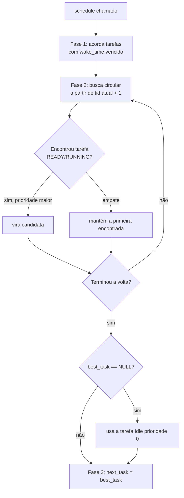

# Tarefas e escalonamento

O escalonador (`src/kernel/scheduler.c` + `include/kernel/task.h`) implementa um modelo de **multitarefa cooperativa-preemptiva por prioridades**, com um pool estático de no máximo `MAX_TASKS = 4` tarefas.

## Estruturas de dados

### Estados de uma tarefa

```c
typedef enum {
    TASK_READY,      // Pronta, aguardando a CPU
    TASK_RUNNING,     // Rodando neste exato momento
    TASK_BLOCKED,     // Dormindo (sleep) ou esperando recurso
    TASK_SUSPENDED    // Pausada manualmente, mas existe
} task_state_t;
```

### `context_t`: o snapshot da CPU

`context_t` guarda os 31 registradores de propósito geral do RISC-V (`x1`–`x31`) mais o CSR `mepc`, totalizando 128 bytes. **O layout desta struct precisa bater exatamente com a ordem de `sw`/`lw` em `trap.s`** — é um contrato implícito entre C e Assembly, documentado no próprio header.

### `task_t`: o Task Control Block (TCB)

```c
typedef struct task_t {
    uint32_t      tid;
    char          name[16];
    task_state_t  state;
    uint32_t      priority;      // 0 (Idle) a N (máxima)
    uint32_t      sp;            // Onde o context_t desta tarefa está salvo
    uint64_t      wake_time;     // Ciclo de mtime em que deve acordar (sleep)
    uint8_t       stack[STACK_SIZE]; // 1 KB — a pilha da tarefa
} task_t;
```

Cada tarefa tem sua **própria pilha de 1 KB**, embutida diretamente no TCB (`tasks[MAX_TASKS]`, um array estático em `scheduler.c`). Não há alocação dinâmica de tarefas — é uma escolha deliberada em sistemas embarcados críticos, para ter uso de memória previsível e evitar fragmentação.

!!! warning "Stack overflow silencioso"
    Como não há MMU nem *guard pages*, se uma tarefa estourar seus 1 KB de pilha ela corrompe silenciosamente a memória da tarefa vizinha no array `tasks[]`. Não há proteção de hardware contra isso.

## Criação de tarefas: "forjando" uma pilha

`task_create()` não inicia a tarefa de fato — ela apenas **monta, na pilha da nova tarefa, um `context_t` falso** que parece o resultado de uma interrupção que nunca aconteceu:

```c
uint32_t sp = (uint32_t)&t->stack[STACK_SIZE];  // topo da pilha
sp -= sizeof(context_t);                         // reserva espaço do contexto
context_t *ctx = (context_t *)sp;

// zera tudo, então define os campos críticos:
ctx->ra   = (uint32_t)function;   // segurança, caso a tarefa dê "return"
ctx->mepc = (uint32_t)function;   // ponto de entrada real (via mret)
ctx->gp   = <gp atual do kernel>; // necessário para acessar globais em C

t->sp = sp; // trap.s vai carregar isso no registrador SP
```

Quando o escalonador escolher essa tarefa pela primeira vez, `trap.s` vai "restaurar" esse contexto forjado exatamente como se estivesse retomando uma tarefa interrompida — e o `mret` salta para `function`, dando início real à execução.

## O algoritmo de escalonamento (`schedule()`)

`schedule()` roda em três fases, e é chamado tanto pela interrupção de timer (preempção) quanto voluntariamente (`sys_yield`, `sys_sleep`, `stop`/`resume` de si mesmo).

### Fase 1 — Acordar tarefas dormindo

```c
uint64_t now = hal_timer_get_cycles();
for (...) {
    if (tasks[i].state == TASK_BLOCKED && now >= tasks[i].wake_time) {
        tasks[i].state = TASK_READY;
    }
}
```

### Fase 2 — Escolher a próxima tarefa

Algoritmo: **round-robin com prioridade estrita**.

- Regra 1: ganha quem tem a **maior prioridade** entre as tarefas `READY`/`RUNNING`.
- Regra 2: em caso de empate, ganha quem for encontrado primeiro numa **busca circular** que começa em `(tid_atual + 1) % task_count` — isso garante alternância justa entre tarefas de mesma prioridade, em vez de sempre favorecer a de menor `tid`.
- Se ninguém está pronto, a tarefa de prioridade `0` (a `Idle`) é escolhida como fallback.



### Fase 3 — Marcar a troca

`schedule()` **não troca a pilha** — ele só atualiza as variáveis globais `current_task` e `next_task`, e ajusta os estados (`READY` → `RUNNING` da nova; `RUNNING` → `READY` da antiga, se forem diferentes). A troca de contexto de fato é feita pelo Assembly em `trap.s`, na volta do trap handler — veja [Interrupções e chamadas de sistema](interrupcoes-syscalls.md#o-trap-handler-central-trap_handler-em-mainc).

## `sleep`, `suspend` e `resume`

- **`scheduler_sleep(ms)`**: converte milissegundos em ciclos de clock usando `hal_timer_get_freq()` (a frequência muda entre QEMU e FPGA — veja [Plataformas e drivers](plataformas-drivers.md)), grava `wake_time = agora + ciclos`, muda o estado para `TASK_BLOCKED` e chama `schedule()` imediatamente — sem esperar o próximo tick do timer.
- **`scheduler_suspend(pid)` / `scheduler_resume(pid)`**: pausam/retomam uma tarefa manualmente (usadas pelos comandos de shell `stop`/`resume`). A tarefa `Idle` (prioridade 0) não pode ser suspensa — é uma checagem de segurança, já que o sistema sempre precisa de um fallback executável.

## Mutexes

`mutex_t` (`include/kernel/mutex.h`) é uma trava simples de **spin + yield**, sem fila de espera nem *priority inheritance*:

```c
typedef struct {
    volatile int locked;
    uint32_t owner_tid;
} mutex_t;
```

A lógica de lock/unlock roda **dentro do kernel**, disparada pelas syscalls `SYS_LOCK`/`SYS_UNLOCK` (veja [Interrupções e chamadas de sistema](interrupcoes-syscalls.md#chamadas-de-sistema)) — o teste-e-ajuste do campo `locked` acontece de forma atômica em relação às tarefas porque o próprio trap handler não é preemptado por outra tarefa (ele roda até o fim antes de qualquer troca de contexto). O padrão de uso típico, usado por `safe_puts()`:

```c
while (sys_mutex_lock(&uart_mutex) == 0) sys_yield();
sys_puts(s);
sys_mutex_unlock(&uart_mutex);
```

Apenas o dono (`owner_tid`) pode destravar um mutex — uma verificação simples contra destravamento indevido por outra tarefa.

## A troca de contexto em Assembly

O mecanismo completo de salvar/restaurar registradores está descrito em [Interrupções e chamadas de sistema → Troca de contexto](interrupcoes-syscalls.md#troca-de-contexto-em-traps), já que ele é parte do mesmo trap handler que atende timer, syscalls e interrupções externas.
