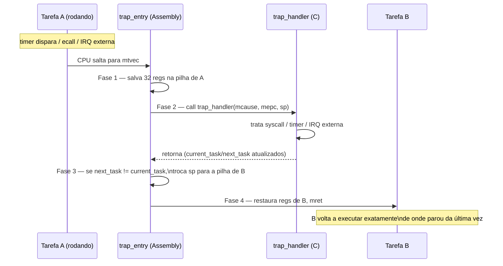
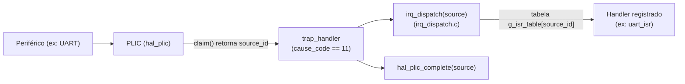

# Interrupções e chamadas de sistema

O coração do AXON-OS é um único ponto de entrada para **tudo que interrompe a execução normal de uma tarefa**: interrupções de hardware (timer, periféricos externos) e exceções de software (syscalls, erros). Esse ponto de entrada é dividido em duas metades — uma em Assembly (`trap.s`) e outra em C (`trap_handler`, em `main.c`).

## Configuração do vetor de trap

No boot, `hal_irq_set_handler(trap_entry)` escreve o endereço de `trap_entry` no CSR `mtvec`, forçando o **modo DIRECT** (bits 1:0 = `00`). Isso significa que, independentemente da causa (`mcause`), a CPU sempre salta para o mesmo endereço — não há vetor de interrupções indexado por causa, como em modos `VECTORED`. Toda a distinção de causa é feita em software, dentro de `trap_handler`.

## Troca de contexto em `trap.s`

`trap_entry` é escrito inteiramente em Assembly porque precisa manipular registradores brutos antes que qualquer código C possa rodar com segurança. Ele tem quatro fases:

### Fase 1 — Congelamento (salvar a tarefa interrompida)

```asm
addi sp, sp, -CTX_SIZE   # CTX_SIZE = 128 (32 registradores * 4 bytes)
sw ra,  0(sp)
sw gp,  8(sp)
sw tp, 12(sp)
... # todos os demais registradores gerais
csrr t0, mepc
sw t0, 124(sp)
addi t0, sp, CTX_SIZE
sw t0, 4(sp)              # salva o SP *original* (antes do addi) no slot x2
```

Todos os 31 registradores gerais (exceto `sp`, tratado à parte) mais `mepc` são empilhados **na própria pilha da tarefa interrompida**, seguindo exatamente o layout de `context_t` (veja [Tarefas e escalonamento](escalonador.md#context_t-o-snapshot-da-cpu)).

### Fase 2 — Chamar o kernel em C

```asm
csrr a0, mcause
csrr a1, mepc
mv   a2, sp
call trap_handler
```

Os três argumentos batem com a assinatura `trap_handler(uint32_t mcause, uint32_t mepc, uint32_t *ctx)`. Como `sp` já aponta para o `context_t` recém-salvo, o kernel consegue ler os argumentos de syscall diretamente da pilha (via os offsets de `a0`–`a7`) e escrever valores de retorno no mesmo lugar.

### Fase 3 — Troca de contexto (se necessário)

Depois que `trap_handler` retorna, `trap.s` compara `current_task` com `next_task` (ambas variáveis globais atualizadas por `schedule()`, veja [Tarefas e escalonamento](escalonador.md#fase-3-marcar-a-troca)):

- Se forem iguais (ou `next_task` for `NULL`), não há troca — segue para a Fase 4 usando a mesma pilha.
- Se forem diferentes: salva o `sp` atual dentro do TCB da tarefa antiga (`sw sp, 28(t1)` — offset calculado manualmente a partir do layout de `task_t`), atualiza `current_task = next_task`, e **carrega o `sp` salvo da nova tarefa** (`lw sp, 28(t3)`). A partir desse `lw`, todo acesso à pilha passa a ler/escrever a pilha da *outra* tarefa.

### Fase 4 — Restauração e retorno

```asm
lw t0, 124(sp)
csrw mepc, t0
lw ra, 0(sp)
... # restaura todos os registradores gerais
addi sp, sp, CTX_SIZE
mret
```

`mret` salta para o endereço em `mepc`, reabilita interrupções globais e retorna ao modo de privilégio anterior — completando o ciclo. Se houve troca de contexto na Fase 3, esse `mepc`/registradores restaurados pertencem à **nova** tarefa, não à que sofreu o trap.



## O trap handler central (`trap_handler`, em `main.c`)

O bit mais significativo de `mcause` distingue interrupção (1) de exceção (0):

```c
int is_interrupt = (mcause >> 31);
int cause_code   = mcause & 0x7FFFFFFF;
```

### Interrupções de hardware

| `cause_code` | Origem | Ação |
|---|---|---|
| `7` | Machine Timer Interrupt | Rearma o próximo tick (`hal_timer_set_irq_delta`) e chama `schedule()` — é assim que a preempção acontece |
| `11` | Machine External Interrupt (PLIC) | `hal_plic_claim()` identifica a fonte, `irq_dispatch(source)` chama o *handler* registrado (veja abaixo), depois `hal_plic_complete(source)` |

### Exceções — `ecall` (síncrona, `cause_code == 11`)

Uma tarefa "chama" o kernel colocando o número da syscall em `a7` e argumentos em `a0`–`a5`, então executa `ecall`. O trap handler lê esses valores diretamente do `context_t` salvo na pilha (ex.: `ctx[16]` é o slot de `a7`) e despacha por um `switch`. Veja a [tabela completa de syscalls](#chamadas-de-sistema) para a lista e assinaturas.

!!! danger "Avançar o PC manualmente"
    Depois de tratar uma `ecall`, o kernel faz `ctx[31] += 4` (o slot de `mepc`) **antes** de retornar. Se isso não fosse feito, o `mret` voltaria para o endereço exato da instrução `ecall`, que seria executada de novo — um laço infinito. `4` é o tamanho fixo de uma instrução RISC-V não-comprimida.

### Exceções não tratadas (crash)

Qualquer `cause_code` diferente de `11` na branch de exceção (ex.: instrução ilegal, acesso a endereço inválido) é tratado como erro fatal: o kernel imprime `mcause`/`mepc` na UART, aguarda 3 segundos (via *busy-wait* de hardware, já que o escalonador não está disponível nesse ponto) e **reinicia o sistema chamando `_start()` diretamente** — não há painic controlado nem dump de pilha, apenas um reboot. O comando de shell `panic` (`asm volatile(".word 0xFFFFFFFF")`, uma instrução ilegal deliberada) existe justamente para exercitar esse caminho.

## Interrupções externas: PLIC + dispatcher

Diferente do timer (tratado diretamente no `switch` de `main.c`), interrupções externas (como a UART) passam por uma camada extra de despacho:



- `hal_irq_register(source_id, handler)` (chamado por `apps_init()` para a UART) grava o ponteiro de função em uma tabela estática `g_isr_table[PLIC_MAX_SOURCES]`, e já habilita a fonte no PLIC com prioridade 1.
- `irq_dispatch(source)` simplesmente indexa essa tabela e chama o *handler*, se houver um registrado.
- O *handler* da UART (`uart_isr`, em `task_shell.c`) lê o caractere recebido e o empurra em um **buffer circular** (`cbuf_t`, `include/util/circular_buffer.h`) — a tarefa do shell consome esse buffer de forma assíncrona, sem bloquear a ISR.

Esse desenho — ISR curta que só empurra dados em uma fila, tarefa consumindo em background — é o padrão clássico para manter o tempo dentro do trap handler mínimo.

## Chamadas de sistema

Todas as syscalls são definidas em `include/sys/syscall.h`. O mecanismo geral (ABI, como o número e os argumentos viajam até o kernel) está descrito na [seção sobre `ecall`](#excecoes-ecall-sincrona-cause_code-11).

### Convenção de chamada

- O número da syscall vai no registrador `a7`.
- Argumentos (até 3, no AXON-OS) vão em `a0`, `a1`, `a2`.
- O valor de retorno (quando houver) volta em `a0`.
- A instrução `ecall` dispara a exceção síncrona.

Cada syscall tem um wrapper `static inline` correspondente em `syscall.h`, que esconde o Assembly bruto — é essa função que as tarefas devem chamar.

### Lista completa

| # | Constante | Wrapper C | Assinatura de retorno/args | Descrição |
|---|---|---|---|---|
| 1 | `SYS_YIELD` | `sys_yield()` | `void` | Cede a CPU voluntariamente para a próxima tarefa pronta |
| 2 | `SYS_WRITE` | `sys_write_char(char c)` / `sys_puts(const char* s)` | `void` | Escreve um caractere (ou string) na UART |
| 3 | `SYS_SLEEP` | `sys_sleep(uint32_t ms)` | `void` | Bloqueia a tarefa atual por `ms` milissegundos |
| 4 | `SYS_LOCK` | `int sys_mutex_lock(mutex_t *m)` | `1` = obteve a trava, `0` = já estava travado | Tenta travar um mutex |
| 5 | `SYS_UNLOCK` | `sys_mutex_unlock(mutex_t *m)` | `void` | Destrava um mutex (só o dono pode) |
| 6 | `SYS_GET_TASKS` | `int sys_get_tasks(task_info_t *buffer, int max_count)` | Nº de tarefas copiadas | Copia informações de todas as tarefas para `buffer` |
| 7 | `SYS_PEEK` | `uint32_t sys_peek(uint32_t addr)` | Valor lido | Lê 32 bits de um endereço físico arbitrário |
| 8 | `SYS_POKE` | `sys_poke(uint32_t addr, uint32_t val)` | `void` | Escreve 32 bits em um endereço físico arbitrário |
| 9 | `SYS_HEAP_INFO` | `sys_heap_info()` | `void` | Imprime o mapa completo do heap na UART (`kheap_dump`) |
| 10 | `SYS_MALLOC` | `void* sys_malloc(uint32_t size)` | Ponteiro alocado ou `NULL` | Aloca memória no heap do kernel |
| 11 | `SYS_FREE` | `uint8_t sys_free(void* ptr)` | `0` = sucesso, não-zero = erro | Libera memória alocada com `sys_malloc` |
| 12 | `SYS_DEFRAG` | `sys_defrag()` | `void` | Funde blocos livres adjacentes no heap |
| 13 | `SYS_SUSPEND` | `int sys_suspend(uint32_t pid)` | `0` = sucesso, `-1` = erro | Suspende uma tarefa pelo PID |
| 14 | `SYS_RESUME` | `int sys_resume(uint32_t pid)` | `0` = sucesso, `-1` = erro | Retoma uma tarefa suspensa pelo PID |
| 15 | `SYS_FS_CREATE` | `sys_fs_create(const char *name)` | `0` = sucesso, `<0` = erro | Cria um arquivo vazio no RamFS |
| 16 | `SYS_FS_WRITE` | `sys_fs_write(const char *name, const uint8_t *data, uint32_t len)` | Bytes escritos ou `<0` | Sobrescreve o conteúdo de um arquivo |
| 17 | `SYS_FS_READ` | `sys_fs_read(const char *name, uint8_t *buffer, uint32_t max_len)` | Bytes lidos ou `<0` | Lê o conteúdo de um arquivo |
| 18 | `SYS_FS_LIST` | `sys_fs_list(char *buffer, uint32_t max_len)` | `0` | Lista os arquivos do diretório raiz |
| 19 | `SYS_FS_DELETE` | `sys_fs_delete(const char *name)` | `0` = sucesso, `<0` = erro | Remove um arquivo |
| 20 | `SYS_FS_FORMAT` | (sem wrapper dedicado) | `0` | Reformata o RamFS |

!!! note "Syscalls sem wrapper `static inline` próprio"
    `SYS_FS_CREATE`, `SYS_FS_WRITE`, `SYS_FS_READ`, `SYS_FS_LIST` e `SYS_FS_DELETE` não têm wrapper em `syscall.h` — eles são implementados diretamente em `src/kernel/file_cmds.c` (`sys_fs_create`, `sys_fs_write`, etc.), próximos aos comandos de shell que os usam, seguindo o mesmo padrão de `asm volatile` com `ecall`.

### `task_info_t`

Struct usada por `sys_get_tasks()` para copiar o estado de todas as tarefas de uma vez:

```c
typedef struct {
    uint32_t id;         // PID (= tid)
    char     name[16];
    uint32_t state;       // 0=Ready, 1=Running, 2=Blocked, 3=Suspended
    uint32_t priority;
    uint32_t sp;           // Stack Pointer atual
    uint64_t wake_time;    // Ciclo de mtime para acordar (se Blocked)
} task_info_t;
```

É o que alimenta o comando de shell [`ps`](../shell.md#ps).

### Exemplo: implementando uma nova syscall

Para adicionar uma syscall nova, três lugares precisam ser tocados:

1. **`include/sys/syscall.h`**: adicionar `#define SYS_MINHA_SYSCALL <próximo número livre>` e, opcionalmente, um wrapper `static inline` no padrão dos existentes.
2. **`src/kernel/main.c`** (`trap_handler`): adicionar um `case SYS_MINHA_SYSCALL:` no `switch`, lendo argumentos de `ctx[9]`/`ctx[10]`/`ctx[11]` (`a0`/`a1`/`a2`) e escrevendo o retorno em `ctx[9]` (`a0`) se aplicável.
3. A **função real** que a syscall invoca deve morar no kernel (`src/kernel/*.c`), nunca em `src/apps/` ou `src/bin/` — o handler roda em contexto de trap, com acesso direto às estruturas internas do kernel.
