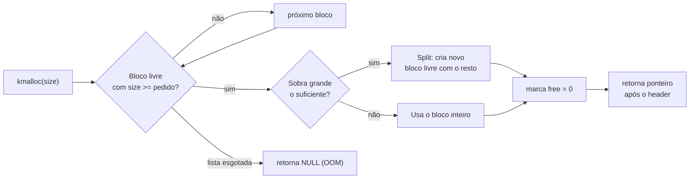

# Gerenciamento de memória

O AXON-OS implementa seu próprio alocador dinâmico (`src/kernel/mm.c`), no estilo clássico de **lista encadeada de blocos com cabeçalho** (*boundary tag* simplificado), com proteção contra corrupção via valores sentinela.

## Onde vive o heap

O heap ocupa toda a RAM que sobra depois do binário do kernel, calculada em `kernel_main()` (veja [Inicialização](visao-geral.md#fase-1-inicializacao-de-hardware)):

```c
uint32_t heap_size = ram_total - kernel_size - 4096; // 4KB de margem para a pilha de boot
kmalloc_init((void*)_end, heap_size);
```

`_end` é o símbolo exportado pelo *linker script* logo após a última seção carregada (`.bss`) — ou seja, **o heap começa exatamente onde o binário do kernel termina** e vai até quase o fim da RAM física.

## Estrutura de um bloco

```c
typedef struct block_meta {
    size_t size;              // Tamanho do dado (sem contar este header)
    struct block_meta *next;  // Próximo bloco na lista
    int free;                 // 1 = Livre, 0 = Ocupado
    uint32_t canary;          // 0xCAFEBABE — detecção de corrupção
} block_t;
```

Cada alocação é precedida por um `block_t` invisível ao chamador. `kmalloc_init()` cria um único "bloco gênesis" cobrindo todo o heap, marcado como livre.

## `kmalloc`: alocação com *first-fit* e *splitting*

1. Alinha o tamanho solicitado em 4 bytes (requisito do RISC-V para acesso eficiente a `uint32_t`).
2. Percorre a lista encadeada procurando o **primeiro** bloco livre grande o suficiente (*first-fit*, não *best-fit*).
3. Se o bloco encontrado for significativamente maior do que o necessário (sobra > `sizeof(block_t) + 8`), ele é **dividido em dois**: a primeira parte vira a alocação, a segunda vira um novo bloco livre inserido na lista.
4. Retorna o ponteiro **depois** do cabeçalho — o chamador nunca vê o `block_t`.
5. Se nenhum bloco couber, retorna `NULL` (OOM).



## `kfree`: liberação com validação

Diferente de um `free()` ingênuo, `kfree()` faz três checagens de segurança antes de marcar o bloco como livre:

1. **Limites do heap**: o ponteiro precisa estar estritamente dentro de `[heap_start, heap_end)`.
2. **Alinhamento**: o ponteiro precisa ser múltiplo de 4.
3. **Canary**: o campo `canary` do cabeçalho (recuperado subtraindo `sizeof(block_t)` do ponteiro) precisa ser exatamente `0xCAFEBABE`. Se não for, o header foi corrompido — por exemplo, por um *buffer overflow* que escreveu além dos limites de uma alocação vizinha — e `kfree()` recusa a operação, retornando erro em vez de silenciosamente corromper a lista encadeada.

`kfree()` **não funde** blocos livres adjacentes automaticamente — essa é uma operação separada.

## `kheap_defrag`: fusão de blocos livres (*coalescing*)

Como o alocador nunca funde blocos livres por conta própria em tempo de `kfree`, blocos pequenos e livres podem se acumular e impedir alocações maiores mesmo que a soma da memória livre seja suficiente (fragmentação externa). `kheap_defrag()` varre a lista **uma vez** fundindo pares de blocos livres adjacentes:

```c
if (curr->free && curr->next->free) {
    curr->size += curr->next->size + BLOCK_SIZE;
    curr->next = curr->next->next; // "engole" o vizinho
    // não avança curr: o bloco fundido pode ter outro vizinho livre à frente
}
```

Note que o laço **não avança o ponteiro** após uma fusão — o bloco recém-aumentado pode ter mais um vizinho livre logo depois, então ele é reexaminado na próxima iteração.

Essa operação é manual: precisa ser disparada explicitamente (comando de shell `defrag` ou syscall `SYS_DEFRAG`) — o kernel não a chama automaticamente em nenhum outro ponto.

## Diagnóstico: `kheap_dump` e `kget_free_memory`

- `kget_free_memory()` soma o campo `size` de todos os blocos com `free == 1`.
- `kheap_dump()` (acionado pelo comando de shell `heap` / syscall `SYS_HEAP_INFO`) imprime uma tabela com endereço do cabeçalho, endereço dos dados, endereço do canary, tamanho, status (`FREE`/`USED`) e resultado da checagem de integridade (`OK`/`ERR`) de cada bloco da lista — útil para depurar fragmentação e vazamentos diretamente no terminal.

## Memória "segura" para tarefas de usuário

Como não há isolamento de memória entre tarefas (veja [Visão geral](visao-geral.md#filosofia-de-projeto)), o AXON-OS adota uma convenção em vez de uma garantia de hardware: tarefas que querem ler/escrever memória arbitrária usam as syscalls `SYS_PEEK`/`SYS_POKE` (endereço bruto, sem verificação), enquanto tarefas que querem um bloco de memória "seu" pedem via `SYS_MALLOC`, recebem um endereço do heap do kernel, e então usam `poke` **apenas** dentro desse bloco por convenção — não há enforcement.

## Resumo da API

| Função | Syscall correspondente | Descrição |
|---|---|---|
| `kmalloc_init(start, size)` | — (chamado só no boot) | Inicializa o heap com um bloco gênesis |
| `kmalloc(size)` | `SYS_MALLOC` | Aloca `size` bytes, retorna ponteiro ou `NULL` |
| `kfree(ptr)` | `SYS_FREE` | Libera um bloco, com checagem de canary |
| `kget_free_memory()` | — (usado por `kheap_dump`) | Soma de bytes livres |
| `kheap_defrag()` | `SYS_DEFRAG` | Funde blocos livres adjacentes |
| `kheap_dump()` | `SYS_HEAP_INFO` | Imprime o mapa completo do heap na UART |
