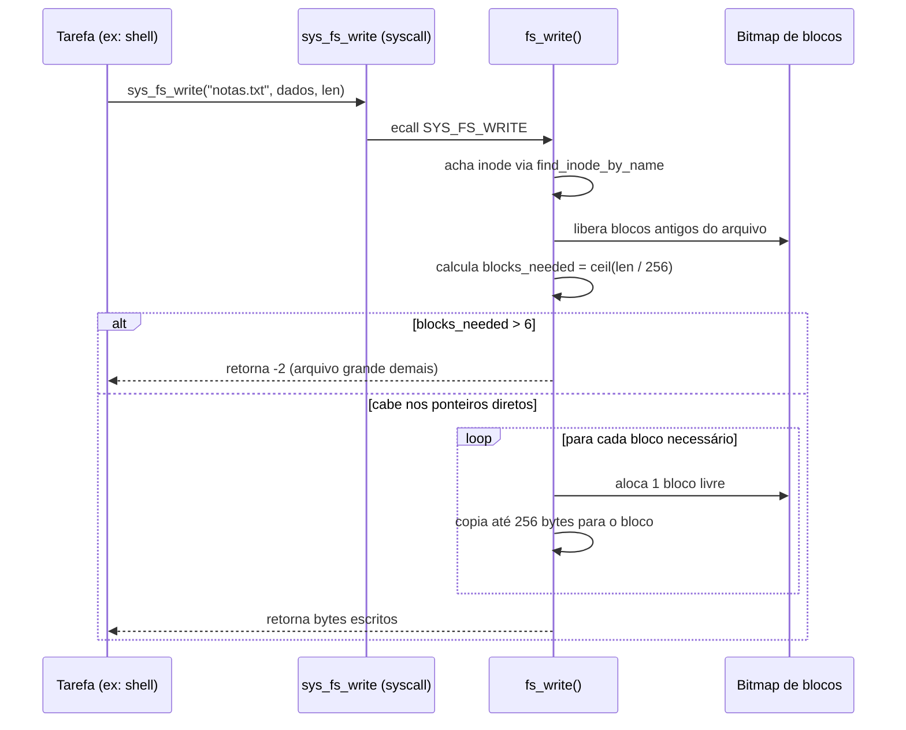

# Sistema de arquivos

O AXON-OS inclui um sistema de arquivos volátil (**RamFS**), implementado em `src/kernel/fs.c`, inspirado na estrutura on-disk clássica do **Ext2** — daí o superbloco com assinatura `0xEF53` (o mesmo *magic number* do Ext2 real) e o layout de bitmaps + tabela de inodes.

!!! info "Volátil por natureza"
    Todo o "disco" vive dentro do heap do kernel (alocado com `kmalloc`), então seu conteúdo é perdido a cada `reboot`. Não há persistência em flash/SD — o foco é demonstrar a mecânica de um sistema de arquivos baseado em inodes, não durabilidade.

## Layout do "disco" virtual

```
[ SUPERBLOCO ] [ BITMAP DE INODES ] [ BITMAP DE BLOCOS ] [ TABELA DE INODES ] [ BLOCOS DE DADOS ]
```

Todo esse layout ocupa uma única região contígua, alocada de uma vez em `fs_init()`:

```c
disk_memory = (uint8_t*)kmalloc(DISK_SIZE);
```

Onde `DISK_SIZE` é calculado em tempo de compilação a partir das constantes de configuração:

| Constante | Valor | Significado |
|---|---|---|
| `FS_BLOCK_SIZE` | 256 bytes | Tamanho de cada bloco de dados |
| `FS_MAX_INODES` | 32 | Número máximo de arquivos/diretórios |
| `FS_MAX_BLOCKS` | 128 | Número máximo de blocos de dados (32 KB de dados no total) |
| `FS_MAGIC` | `0xEF53` | Assinatura do superbloco (herdada do Ext2) |

## Estruturas on-disk

### Superbloco

```c
typedef struct {
    uint16_t magic;        // 0xEF53
    uint16_t inode_count;  // 32
    uint16_t block_count;  // 128
    uint16_t free_inodes;
    uint16_t free_blocks;
} superblock_t;
```

### Inode

O inode guarda **tudo sobre o arquivo, exceto o nome**:

```c
typedef struct {
    uint32_t size;
    uint16_t type;        // 0 = livre, 1 = arquivo, 2 = diretório
    uint16_t blocks_cnt;
    uint16_t blocks[6];   // ponteiros diretos — só suporta arquivos até 6 * 256 = 1.5 KB
} inode_t;
```

!!! note "Sem blocos indiretos"
    Como só há ponteiros diretos (sem blocos de indireção simples/dupla, como no Ext2 real), o tamanho máximo de um arquivo é limitado a **1.536 bytes** (`6 × FS_BLOCK_SIZE`). `fs_write()` retorna erro (`-2`) se o dado não couber nos 6 blocos.

### Entrada de diretório

```c
#define FS_MAX_NAME 28
typedef struct {
    uint16_t inode_idx;         // qual inode este nome descreve
    char     name[FS_MAX_NAME]; // nome "humano" do arquivo
} dirent_t;
```

O nome do arquivo mora na entrada de diretório, **não** no inode — exatamente como no Ext2 real, o que permite (em teoria) hard links, embora o AXON-OS não implemente essa funcionalidade.

## Diretório raiz e sem subdiretórios

O **inode 0 é sempre o diretório raiz**, criado por `fs_format()`. Todos os arquivos ficam nele — o RamFS **não suporta subdiretórios** (o campo `type == 2` existe na struct, mas só é usado para o inode raiz). Uma entrada de diretório vazia é marcada com `inode_idx == 0xFFFF` (sentinela escolhida porque `0` já é um índice de inode válido — o do root).

## Bitmaps de alocação

Inodes e blocos livres são rastreados por bitmaps simples (`alloc_bit`/`free_bit`), com varredura linear bit a bit — adequado para os tamanhos pequenos do projeto (32 inodes = 4 bytes de bitmap; 128 blocos = 16 bytes de bitmap).

## Operações

| Função | O que faz |
|---|---|
| `fs_format()` | Zera todo o "disco", recria o superbloco e o diretório raiz |
| `fs_init()` | Aloca `DISK_SIZE` no heap, mapeia os ponteiros de região e chama `fs_format()` — **sempre** formata no boot, já que o RamFS é volátil |
| `fs_create(name)` | Aloca um inode livre, cria uma entrada no diretório raiz |
| `fs_write(name, data, len)` | Libera os blocos antigos do arquivo (se houver) e escreve os novos — **sempre sobrescreve o arquivo inteiro**, sem suporte a escrita parcial/append |
| `fs_read(name, buffer, max_len)` | Copia até `min(inode->size, max_len)` bytes para o buffer |
| `fs_delete(name)` | Libera os blocos de dados e o inode, remove a entrada do diretório raiz |
| `fs_list(buffer, max_len)` | Formata a listagem de arquivos como texto (indentado, uma linha por arquivo) |

### Busca por nome

`find_inode_by_name()` faz uma busca linear pelas entradas do(s) bloco(s) de dados do diretório raiz, comparando strings caractere a caractere — não há índice/hash, mas com no máximo 32 arquivos isso não é um problema de desempenho relevante.

## Fluxo de uma escrita



## Acesso via shell e syscalls

O sistema de arquivos é exposto ao espaço de tarefas por seis syscalls (`SYS_FS_CREATE`, `SYS_FS_WRITE`, `SYS_FS_READ`, `SYS_FS_LIST`, `SYS_FS_DELETE`, `SYS_FS_FORMAT` — veja [tabela completa](../referencia/api-syscalls.md)), e por sua vez pelos comandos de shell `touch`, `write`, `cat`, `ls`, `rm` e pelo editor `edit` (veja [Usando o shell](../guias/shell.md#o-editor-edit)).
