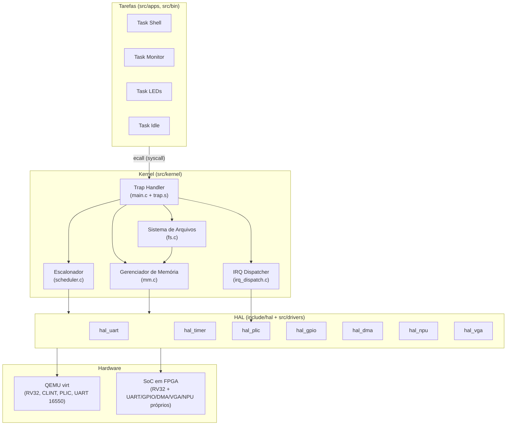

# Visão geral

## Filosofia de projeto

O AXON-OS roda inteiramente em **Modo Máquina (M-mode)** do RISC-V — tanto o kernel quanto as tarefas de usuário compartilham o mesmo nível de privilégio máximo. Não há MMU, não há isolamento de memória entre tarefas, e não há modo usuário (U-mode). Essa é uma simplificação deliberada e documentada: o foco do projeto é a mecânica de escalonamento, gerência de memória, sistema de arquivos e a integração com um SoC customizado — não a construção de um sistema de proteção completo.

Ainda assim, o AXON-OS usa a instrução `ecall` para separar tarefas do kernel através de uma **fronteira lógica de syscalls** (veja [Interrupções e syscalls](interrupcoes-syscalls.md)), pelo mesmo motivo que sistemas "de verdade" fazem: organização do código e compatibilidade com uma futura adição de modo usuário, sem reescrever as tarefas.

## Camadas do sistema

## Fluxo de execução, em uma frase

1. `start.s` prepara a pilha e zera o `.bss`, então chama `kernel_main()`.
2. `kernel_main()` inicializa drivers, o heap, o sistema de arquivos, as interrupções e cria as tarefas iniciais.
3. `kernel_main()` chama `schedule()` uma única vez e "morre" — a partir daí, o controle da CPU pertence às tarefas e ao trap handler.
4. O sistema inteiro passa a viver de eventos: o **timer** dispara a cada 100 ms (preempção) e as **syscalls**/**interrupções externas** (UART, etc.) chamam de volta o kernel sob demanda.

Veja o detalhamento completo em [Boot](boot.md).

## Duas plataformas, um kernel

O AXON-OS foi desenhado para compilar, sem alterar uma linha de código do kernel, para dois alvos:

| | QEMU (`virt`) | FPGA (SoC customizado) |
|---|---|---|
| Uso | Desenvolvimento rápido, sem hardware | Alvo final do projeto |
| Clock | 10 MHz | 100 MHz |
| UART | 16550 padrão | Registrador customizado (`UART_DATA_REG`/`UART_CTRL_REG`) |
| CLINT / PLIC | Layout SiFive padrão | Layout próprio (offsets diferentes) |
| Periféricos extras | — | GPIO, DMA, VGA, **NPU** (acelerador de rede neural) |

Essa portabilidade é possível porque todo acesso a hardware passa por uma **camada HAL** (`include/hal/*.h`) com uma implementação por plataforma em `src/drivers/qemu/` e `src/drivers/fpga/`. O `makefile` escolhe qual conjunto de drivers linkar. Veja [HAL e drivers](hal-drivers.md).

## Onde cada coisa mora no código

| Assunto | Arquivos principais |
|---|---|
| Boot / entrada | `src/bsp/start.s`, `src/bsp/link.ld`, `src/bsp/link_fpga.ld` |
| Trap handler central | `src/kernel/main.c` (`trap_handler`), `src/kernel/trap.s` |
| Escalonador | `src/kernel/scheduler.c`, `include/kernel/task.h` |
| Memória (heap) | `src/kernel/mm.c`, `include/kernel/mm.h` |
| Sistema de arquivos | `src/kernel/fs.c`, `include/kernel/fs.h` |
| Syscalls | `include/sys/syscall.h`, `switch` em `main.c` |
| Interrupções (PLIC) | `src/kernel/irq_dispatch.c`, `include/hal/hal_irq.h`, `include/hal/hal_plic.h` |
| HAL | `include/hal/*.h`, `src/drivers/{qemu,fpga}/*.c` |
| Tarefas de usuário | `src/apps/*.c` |
| Comandos do shell | `src/bin/*.c`, `src/kernel/file_cmds.c` |
