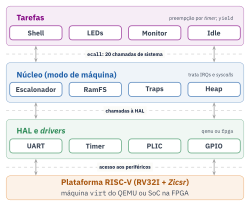
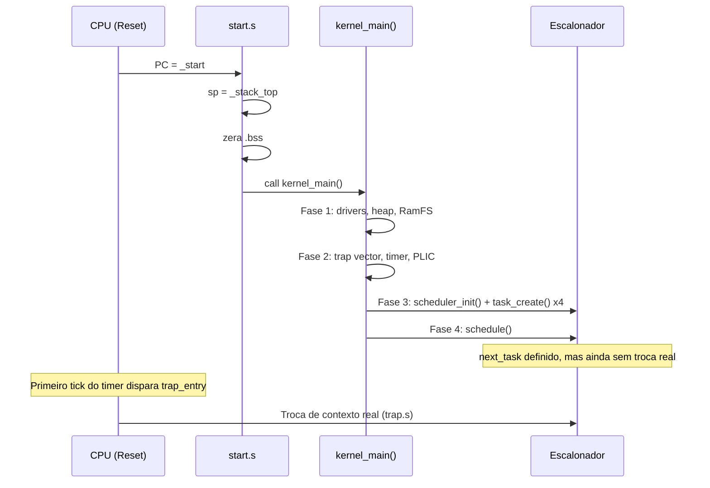

# Visão geral e inicialização

## Filosofia de projeto

O AXON-OS roda inteiramente em **Modo Máquina (M-mode)** do RISC-V — tanto o kernel quanto as tarefas de usuário compartilham o mesmo nível de privilégio máximo. Não há MMU, não há isolamento de memória entre tarefas, e não há modo usuário (U-mode). Essa é uma simplificação deliberada e documentada: o foco do projeto é a mecânica de escalonamento, gerência de memória, sistema de arquivos e a integração com um SoC customizado — não a construção de um sistema de proteção completo.

Ainda assim, o AXON-OS usa a instrução `ecall` para separar tarefas do kernel através de uma **fronteira lógica de syscalls** (veja [Interrupções e chamadas de sistema](interrupcoes-syscalls.md)), pelo mesmo motivo que sistemas "de verdade" fazem: organização do código e compatibilidade com uma futura adição de modo usuário, sem reescrever as tarefas.

## Camadas do sistema

<figure class="ax-figura" markdown>
  { width="560" }
  <figcaption>Camadas do AXON-OS. As tarefas chamam o núcleo por <code>ecall</code>; o núcleo acessa o hardware só pela HAL, cuja implementação muda entre QEMU e FPGA.</figcaption>
</figure>

As tarefas (`src/apps`, `src/bin`) rodam sobre o núcleo (`src/kernel`), que reúne o escalonador, o gerenciador de memória, o sistema de arquivos e o tratamento de *traps*. O núcleo nunca acessa periféricos diretamente: tudo passa pela HAL (`include/hal` e `src/drivers`), o que permite compilar o mesmo núcleo para os dois alvos.

## Fluxo de execução, em uma frase

1. `start.s` prepara a pilha e zera o `.bss`, então chama `kernel_main()`.
2. `kernel_main()` inicializa drivers, o heap, o sistema de arquivos, as interrupções e cria as tarefas iniciais.
3. `kernel_main()` chama `schedule()` uma única vez e "morre" — a partir daí, o controle da CPU pertence às tarefas e ao trap handler.
4. O sistema inteiro passa a viver de eventos: o **timer** dispara a cada 100 ms (preempção) e as **syscalls**/**interrupções externas** (UART, etc.) chamam de volta o kernel sob demanda.

O detalhamento está na seção [Inicialização](#inicializacao).

## Duas plataformas, um kernel

O AXON-OS foi desenhado para compilar, sem alterar uma linha de código do kernel, para dois alvos:

| | QEMU (`virt`) | FPGA (SoC customizado) |
|---|---|---|
| Uso | Desenvolvimento rápido, sem hardware | Alvo final do projeto |
| Clock | 10 MHz | 100 MHz |
| UART | 16550 padrão | Registrador customizado (`UART_DATA_REG`/`UART_CTRL_REG`) |
| CLINT / PLIC | Layout SiFive padrão | Layout próprio (offsets diferentes) |
| Periféricos extras | — | GPIO, DMA, VGA, **NPU** (acelerador de rede neural) |

Essa portabilidade é possível porque todo acesso a hardware passa por uma **camada HAL** (`include/hal/*.h`) com uma implementação por plataforma em `src/drivers/qemu/` e `src/drivers/fpga/`. O `makefile` escolhe qual conjunto de drivers linkar. Veja [Plataformas e drivers](plataformas-drivers.md).

## Inicialização

### Do reset ao C

O ponto de entrada do AXON-OS é o símbolo `_start`, definido em `src/bsp/start.s` e apontado pelo linker script como `ENTRY`. Ele faz o mínimo indispensável antes de entregar o controle ao código C:

```asm
_start:
    # 1. Stack pointer
    la sp, _stack_top

    # 2. Zerar BSS
    la t0, _bss_start
    la t1, _bss_end
bss_loop:
    bge t0, t1, bss_done
    sw zero, 0(t0)
    addi t0, t0, 4
    j bss_loop
bss_done:
    # 3. Entrar no kernel C
    call kernel_main

hang:
    wfi
    j hang
```

1. **Stack pointer**: carrega `sp` com `_stack_top`, o topo da RAM disponível (símbolo definido pelo *linker script*, veja abaixo).
2. **Zerar `.bss`**: variáveis globais não inicializadas (`.bss`/`.sbss`) não vêm zeradas da ROM/RAM — o loop `bss_loop` percorre a região `[_bss_start, _bss_end)` em passos de 4 bytes escrevendo zero. Isso é essencial: código C assume que globais sem inicializador começam em zero.
3. **`call kernel_main`**: transfere o controle para `src/kernel/main.c`.
4. **`hang`**: rede de segurança — se `kernel_main()` algum dia retornar (não deveria, veja abaixo), a CPU entra em um laço de `wfi` (*Wait For Interrupt*) em vez de executar instruções aleatórias na memória.

### Linker script

Cada plataforma tem seu próprio *linker script*, porque o layout de memória físico é diferente:

=== "QEMU (`src/bsp/link.ld`)"

    ```ld
    MEMORY
    {
      ram (wxa) : ORIGIN = 0x80000000, LENGTH = 256K
    }
    ```

    A RAM do modelo `virt` do QEMU começa em `0x80000000` — endereço padrão de várias plataformas RISC-V. O AXON-OS reserva 256 KB para si.

=== "FPGA (`src/bsp/link_fpga.ld`)"

    ```ld
    MEMORY
    {
      /* ORIGIN: 0x80000800 (pula 2KB do bootloader)
         LENGTH: 254KB (256KB total - 2KB reservados) */
      ram (wxa) : ORIGIN = 0x80000800, LENGTH = 254K
    }
    ```

    Na FPGA, os primeiros 2 KB da RAM são reservados para o **bootloader residente** na placa (o mesmo que fala o protocolo usado por [`upload.py`](../primeiros-passos.md#execucao-na-fpga)) — por isso o kernel começa 2 KB depois do início físico da RAM.

Em ambos os casos, as seções seguem a mesma ordem — `.text`, `.rodata`, `.data`/`.sdata`, `.bss`/`.sbss` — e o linker exporta os símbolos usados pelo boot e pelo kernel:

| Símbolo | Uso |
|---|---|
| `_text_start` / `_text_end` | Limites do código executável |
| `_bss_start` / `_bss_end` | Região a ser zerada por `start.s` |
| `_end` | Fim de todas as seções carregadas — **é aqui que o heap começa** (veja [Gerenciamento de memória](memoria.md)) |
| `_stack_top` | Topo da pilha de boot, usado por `start.s` antes de `kernel_main` criar as pilhas das tarefas |

### `kernel_main()`: as quatro fases

`src/kernel/main.c` documenta o próprio fluxo em um comentário de topo:

```
1. Bootloader (start.s) configura a pilha e chama kernel_main().
2. kernel_main() inicializa drivers e cria as tarefas.
3. kernel_main() chama schedule() e "morre" — o controle passa para as tarefas.
4. O sistema vive de Interrupções (Timer) e Exceções (Syscalls).
```

#### Fase 1 — Inicialização de hardware

- `hal_uart_init()` e limpeza de tela via sequências ANSI, seguido do banner ASCII do AXON.
- Diagnóstico de uso de memória do kernel: `_start` e `_end` (símbolos do linker) são usados para calcular e imprimir o tamanho do binário carregado.
- **Inicialização do heap**: `kmalloc_init((void*)_end, heap_size)`, onde `heap_size = RAM_TOTAL - kernel_size - 4096` (os últimos 4 KB da RAM total ficam reservados como margem de segurança para a pilha de boot).
- **Inicialização do sistema de arquivos**: `fs_init()`, que por sua vez chama `kmalloc()` para reservar a região do RamFS dentro do heap recém-criado (veja [Sistema de arquivos](sistema-arquivos.md)).

#### Fase 2 — Configuração de interrupções

- `hal_irq_set_handler(trap_entry)`: escreve o endereço de `trap_entry` (definido em `trap.s`) no CSR `mtvec`, em modo `DIRECT` — ou seja, **toda** interrupção ou exceção, de qualquer causa, salta para o mesmo ponto de entrada.
- `hal_timer_set_irq_delta(TICK_DELTA_CYCLES)` arma o primeiro tick do timer (`TICK_DELTA_CYCLES = 1.000.000` ciclos — 100 ms a 10 MHz no QEMU).
- `hal_irq_mask_enable(IRQ_M_TIMER)` e `hal_irq_global_enable()` habilitam, respectivamente, a interrupção de timer específica e o bit global `MIE` do `mstatus`.
- `hal_irq_init()` inicializa o PLIC (zera prioridades/enables) e habilita interrupções externas (`IRQ_M_EXT`).
- `apps_init()` registra o *handler* de interrupção da UART no PLIC (necessário para o shell receber teclado via IRQ em vez de polling).

#### Fase 3 — Criação de processos

```c
scheduler_init();
task_create(task_leds,    "Task LEDs",    1);
task_create(task_monitor, "Task Monitor", 1);
task_create(task_shell,   "Task Shell",   2);
task_create(task_idle,    "Idle",         0);
```

Quatro tarefas são criadas — o máximo suportado pelo sistema (`MAX_TASKS = 4`, veja [Tarefas e escalonamento](escalonador.md)). A tarefa `Idle` é obrigatória: com prioridade 0, ela só roda quando nenhuma outra tarefa está pronta, e existe para o `schedule()` sempre ter alguém a entregar a CPU.

#### Fase 4 — Primeiro agendamento

```c
schedule();
while (1) asm volatile("nop");
```

A chamada final a `schedule()` escolhe a primeira tarefa e prepara `next_task`. Mas note: **`kernel_main()` nunca de fato troca de contexto sozinho** — quem executa a troca é o Assembly em `trap.s`, disparado normalmente por uma interrupção. Como aqui não houve trap, `current_task` continua `NULL` e `next_task` aponta para a tarefa escolhida; a primeira troca de contexto real acontece no primeiro tick do timer, alguns milissegundos depois. O `while(1) nop` após o `schedule()` é apenas uma rede de segurança — código inalcançável em operação normal.

### Diagrama do fluxo


