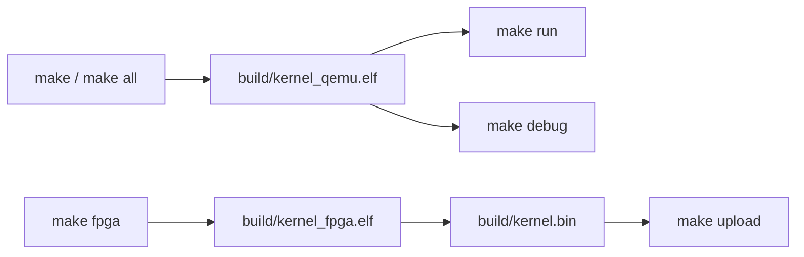

# Build e execução

O sistema de build do AXON-OS é um único `makefile` na raiz do projeto, capaz de gerar **dois binários diferentes** a partir da mesma base de código: um para o **QEMU** e outro para a **FPGA**.

## Como o `makefile` decide o que compilar

Os fontes são divididos em quatro grupos:

| Grupo | Localização | Descrição |
|---|---|---|
| Comuns | `src/kernel/*.c`, `src/bsp/start.s`, `src/kernel/trap.s` | Kernel e bootloader — idênticos nas duas plataformas |
| Apps | `src/apps/*.c` | Tarefas de usuário (shell, monitor, LEDs) |
| Bin | `src/bin/*.c` | Implementação dos comandos do shell |
| Drivers | `src/drivers/qemu/*.c` **ou** `src/drivers/fpga/*.c` | Implementação da HAL, específica por plataforma |

Cada grupo é compilado para um diretório de objetos espelhado — `build/obj/qemu/...` ou `build/obj/fpga/...` — para que os dois builds nunca se misturem. A única diferença de flags entre eles é a definição `-DPLATFORM_FPGA`, usada pelo código para desviar comportamento específico da placa quando necessário, e o *linker script* usado (veja [Boot](../arquitetura/boot.md#linker-script) para os detalhes de memória de cada um).

## Comandos disponíveis

Todos os comandos abaixo devem ser executados na raiz do repositório.

### Compilar para o QEMU (padrão)

```bash
make
# equivalente a "make all"
```

Gera `build/kernel_qemu.elf`, linkado com `src/bsp/link.ld`.

### Rodar no QEMU

```bash
make run
```

Compila (se necessário) e inicia:

```bash
qemu-system-riscv32 -nographic -machine virt -bios none -kernel build/kernel_qemu.elf
```

- `-nographic`: redireciona a UART do kernel para o próprio terminal — é assim que você vê o banner de boot e interage com o shell.
- `-bios none`: pula qualquer *firmware*/SBI padrão do QEMU; o AXON-OS assume controle total da máquina desde o primeiro ciclo, em Modo Máquina.
- `-machine virt`: modelo de máquina genérico do QEMU, cujo mapa de memória (UART 16550, CLINT, PLIC) é o que `src/drivers/qemu/memory_map.h` reflete.

Para sair do QEMU, use `Ctrl+A` seguido de `X`.

### Depurar com GDB

```bash
make debug
```

Igual ao `run`, mas com `-s -S`: abre um servidor GDB na porta `1234` e **pausa a CPU no primeiro ciclo**, esperando o depurador conectar. Em outro terminal:

```bash
riscv64-unknown-elf-gdb build/kernel_qemu.elf -ex "target remote :1234"
```

### Compilar para a FPGA

```bash
make fpga
```

Compila com `-DPLATFORM_FPGA`, linka contra `src/bsp/link_fpga.ld` e gera:

1. `build/kernel_fpga.elf` — o binário ELF (com símbolos, útil para debug);
2. `build/kernel.bin` — a imagem binária pura (via `objcopy -O binary`), pronta para ser gravada na placa.

### Gravar na FPGA

```bash
make upload
```

Roda `python3 upload.py --file build/kernel.bin`. Veja [Upload para a FPGA](upload-fpga.md) para o protocolo completo.

### Limpar o build

```bash
make clean
```

Remove o diretório `build/` inteiro (objetos e binários das duas plataformas).

## Resumo dos alvos


