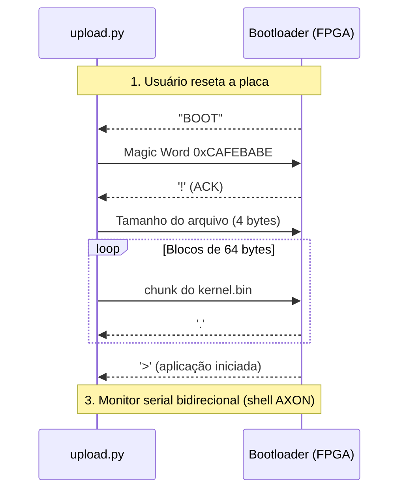

# Upload para a FPGA

O script [`upload.py`](https://github.com/nyfeu/AXON-OS/blob/main/upload.py), na raiz do projeto, é um gravador/monitor serial usado para enviar o binário compilado (`build/kernel.bin`) para a FPGA através de um bootloader residente na placa, e depois abrir um monitor serial interativo.

## Uso básico

```bash
python3 upload.py --file build/kernel.bin
```

ou, via atalho do `makefile`:

```bash
make upload
```

## Opções de linha de comando

| Flag | Padrão | Descrição |
|---|---|---|
| `-p`, `--port` | `/dev/ttyUSB1` | Porta serial conectada à FPGA |
| `-b`, `--baud` | `921600` | Baud rate da UART |
| `-f`, `--file` | `app.bin` | Caminho do binário a ser gravado |

Exemplo customizando a porta:

```bash
python3 upload.py --port /dev/ttyUSB0 --file build/kernel.bin
```

!!! tip "Permissão de porta serial no Linux"
    Se a conexão falhar com erro de permissão, libere o acesso ao dispositivo:
    ```bash
    sudo chmod 666 /dev/ttyUSB0
    ```

## O protocolo de upload

O script segue quatro fases, todas visíveis no terminal com logs coloridos e timestamp:

1. **Espera pelo bootloader** — o script fica ouvindo a porta serial até detectar a string `"BOOT"`, enviada pelo bootloader da FPGA assim que ela é resetada. Por isso, o script pede explicitamente para você **apertar o botão de reset da placa** depois de iniciar o `upload.py`.
2. **Handshake** — ao detectar o bootloader, o script envia uma *magic word* (`0xCAFEBABE`) e aguarda um ACK (`'!'`). Em seguida, envia o tamanho do arquivo (4 bytes, little-endian) para que o bootloader saiba quantos bytes esperar.
3. **Transferência** — o binário é enviado em blocos (*chunks*) de 64 bytes, com uma barra de progresso no terminal. O upload pode ser cancelado a qualquer momento com `Esc`.
4. **Confirmação e monitor** — o bootloader responde com `'.'` (progresso) até enviar `'>'`, confirmando que a aplicação está executando. Nesse momento, o script entra automaticamente em **modo monitor serial**, repassando bidirecionalmente tudo que é digitado no terminal para a UART da FPGA (e vice-versa) — é assim que você acessa o [shell do AXON-OS](shell.md) rodando na placa.

Para sair do monitor serial, pressione `Esc` ou `Ctrl+C`.


