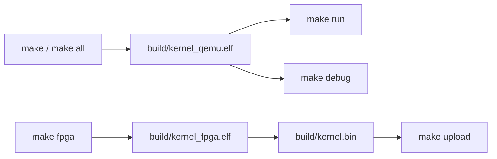
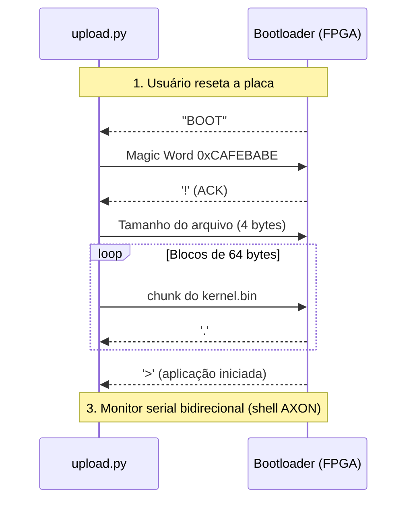

# Primeiros passos

Este capítulo descreve como preparar o ambiente, compilar o AXON-OS e executá-lo no emulador QEMU ou no SoC em FPGA.

## Instalação do ambiente

Para compilar e executar o AXON-OS você precisa de três coisas: um **toolchain RISC-V** (compilador cruzado), o **QEMU** (para rodar sem hardware físico) e, opcionalmente, **Python + pyserial** (para gravar o binário na FPGA).

### 1. Toolchain RISC-V (`riscv64-unknown-elf-gcc`)

O `makefile` do projeto usa o compilador `riscv64-unknown-elf-gcc` com as flags:

```
-march=rv32i_zicsr -mabi=ilp32 -mcmodel=medany -ffreestanding -O0 -g -Wall
```

Ou seja, mesmo sendo um toolchain "64-bit" no nome (`riscv64-unknown-elf-*`), ele é usado aqui para gerar código **32-bit** (`rv32i` com a extensão `Zicsr`, necessária para instruções de CSR como `csrw`/`csrr` usadas no trap handler).

=== "Ubuntu/Debian"

    ```bash
    sudo apt update
    sudo apt install gcc-riscv64-unknown-elf
    ```

    !!! note
        Dependendo da distro, o pacote pode se chamar `gcc-riscv64-unknown-elf` ou `binutils-riscv64-unknown-elf`. Verifique com `apt search riscv64-unknown-elf`.

=== "Compilando da fonte"

    Caso o pacote não esteja disponível no seu gerenciador de pacotes, compile o [riscv-gnu-toolchain](https://github.com/riscv-collab/riscv-gnu-toolchain) oficial, habilitando o suporte a `elf` (baremetal, sem `linux`):

    ```bash
    git clone --recursive https://github.com/riscv-collab/riscv-gnu-toolchain
    cd riscv-gnu-toolchain
    ./configure --prefix=/opt/riscv
    make -j"$(nproc)"
    export PATH="/opt/riscv/bin:$PATH"
    ```

Confirme a instalação:

```bash
riscv64-unknown-elf-gcc --version
riscv64-unknown-elf-objcopy --version
```

### 2. QEMU (`qemu-system-riscv32`)

O AXON-OS roda no modelo de máquina `virt` do QEMU para RISC-V 32-bit — é o alvo padrão de desenvolvimento, sem precisar de hardware.

=== "Ubuntu/Debian"

    ```bash
    sudo apt install qemu-system-misc
    ```

=== "Verificação"

    ```bash
    qemu-system-riscv32 --version
    ```

### 3. Python + pyserial (opcional, só para FPGA)

O script `upload.py`, usado para gravar o binário compilado na FPGA via serial, depende de [`pyserial`](https://pypi.org/project/pyserial/):

```bash
pip install pyserial
```

Esta etapa só é necessária se você for gravar o AXON-OS em uma placa FPGA real — para desenvolvimento via QEMU ela pode ser pulada.

## Compilação e execução

O sistema de build do AXON-OS é um único `makefile` na raiz do projeto, capaz de gerar **dois binários diferentes** a partir da mesma base de código: um para o **QEMU** e outro para a **FPGA**.

### Como o `makefile` decide o que compilar

Os fontes são divididos em quatro grupos:

| Grupo | Localização | Descrição |
|---|---|---|
| Comuns | `src/kernel/*.c`, `src/bsp/start.s`, `src/kernel/trap.s` | Kernel e bootloader — idênticos nas duas plataformas |
| Apps | `src/apps/*.c` | Tarefas de usuário (shell, monitor, LEDs) |
| Bin | `src/bin/*.c` | Implementação dos comandos do shell |
| Drivers | `src/drivers/qemu/*.c` **ou** `src/drivers/fpga/*.c` | Implementação da HAL, específica por plataforma |

Cada grupo é compilado para um diretório de objetos espelhado — `build/obj/qemu/...` ou `build/obj/fpga/...` — para que os dois builds nunca se misturem. A única diferença de flags entre eles é a definição `-DPLATFORM_FPGA`, usada pelo código para desviar comportamento específico da placa quando necessário, e o *linker script* usado (veja [Linker script](arquitetura/visao-geral.md#linker-script) para os detalhes de memória de cada um).

### Comandos disponíveis

Todos os comandos abaixo devem ser executados na raiz do repositório.

#### Compilar para o QEMU (padrão)

```bash
make
# equivalente a "make all"
```

Gera `build/kernel_qemu.elf`, linkado com `src/bsp/link.ld`.

#### Rodar no QEMU

```bash
make run
```

Compila (se necessário) e inicia:

```bash
qemu-system-riscv32 -nographic -machine virt -bios none -kernel build/kernel_qemu.elf
```

- `-nographic`: redireciona a UART do kernel para o próprio terminal — é assim que você vê o banner de boot e interage com o shell.
- `-bios none`: pula qualquer *firmware*/SBI padrão do QEMU; o AXON-OS assume controle total da máquina desde o primeiro ciclo, em Modo Máquina.
- `-machine virt`: modelo de máquina genérico do QEMU, cujo mapa de memória (UART 16550, CLINT, PLIC) é o que `src/drivers/qemu/memory_map.h` reflete.

Para sair do QEMU, use `Ctrl+A` seguido de `X`.

#### Depurar com GDB

```bash
make debug
```

Igual ao `run`, mas com `-s -S`: abre um servidor GDB na porta `1234` e **pausa a CPU no primeiro ciclo**, esperando o depurador conectar. Em outro terminal:

```bash
riscv64-unknown-elf-gdb build/kernel_qemu.elf -ex "target remote :1234"
```

#### Compilar para a FPGA

```bash
make fpga
```

Compila com `-DPLATFORM_FPGA`, linka contra `src/bsp/link_fpga.ld` e gera:

1. `build/kernel_fpga.elf` — o binário ELF (com símbolos, útil para debug);
2. `build/kernel.bin` — a imagem binária pura (via `objcopy -O binary`), pronta para ser gravada na placa.

#### Gravar na FPGA

```bash
make upload
```

Roda `python3 upload.py --file build/kernel.bin`. Veja [Execução na FPGA](#execucao-na-fpga) para o protocolo completo.

#### Limpar o build

```bash
make clean
```

Remove o diretório `build/` inteiro (objetos e binários das duas plataformas).

### Resumo dos alvos



## Execução na FPGA

O script [`upload.py`](https://github.com/RISC-V-Azedinha/AXON-OS/blob/main/upload.py), na raiz do projeto, é um gravador/monitor serial usado para enviar o binário compilado (`build/kernel.bin`) para a FPGA através de um bootloader residente na placa, e depois abrir um monitor serial interativo.

### Uso básico

```bash
python3 upload.py --file build/kernel.bin
```

ou, via atalho do `makefile`:

```bash
make upload
```

### Opções de linha de comando

| Flag | Padrão | Descrição |
|---|---|---|
| `-p`, `--port` | `/dev/ttyUSB1` | Porta serial conectada à FPGA |
| `-b`, `--baud` | `921600` | Baud rate da UART |
| `-f`, `--file` | `app.bin` | Caminho do binário a ser gravado |

Exemplo customizando a porta:

```bash
python3 upload.py --port /dev/ttyUSB0 --file build/kernel.bin
```

!!! tip "Permissão de porta serial no Linux"
    Se a conexão falhar com erro de permissão, libere o acesso ao dispositivo:
    ```bash
    sudo chmod 666 /dev/ttyUSB0
    ```

### O protocolo de upload

O script segue quatro fases, todas visíveis no terminal com logs coloridos e timestamp:

1. **Espera pelo bootloader** — o script fica ouvindo a porta serial até detectar a string `"BOOT"`, enviada pelo bootloader da FPGA assim que ela é resetada. Por isso, o script pede explicitamente para você **apertar o botão de reset da placa** depois de iniciar o `upload.py`.
2. **Handshake** — ao detectar o bootloader, o script envia uma *magic word* (`0xCAFEBABE`) e aguarda um ACK (`'!'`). Em seguida, envia o tamanho do arquivo (4 bytes, little-endian) para que o bootloader saiba quantos bytes esperar.
3. **Transferência** — o binário é enviado em blocos (*chunks*) de 64 bytes, com uma barra de progresso no terminal. O upload pode ser cancelado a qualquer momento com `Esc`.
4. **Confirmação e monitor** — o bootloader responde com `'.'` (progresso) até enviar `'>'`, confirmando que a aplicação está executando. Nesse momento, o script entra automaticamente em **modo monitor serial**, repassando bidirecionalmente tudo que é digitado no terminal para a UART da FPGA (e vice-versa) — é assim que você acessa o [shell do AXON-OS](shell.md) rodando na placa.

Para sair do monitor serial, pressione `Esc` ou `Ctrl+C`.


